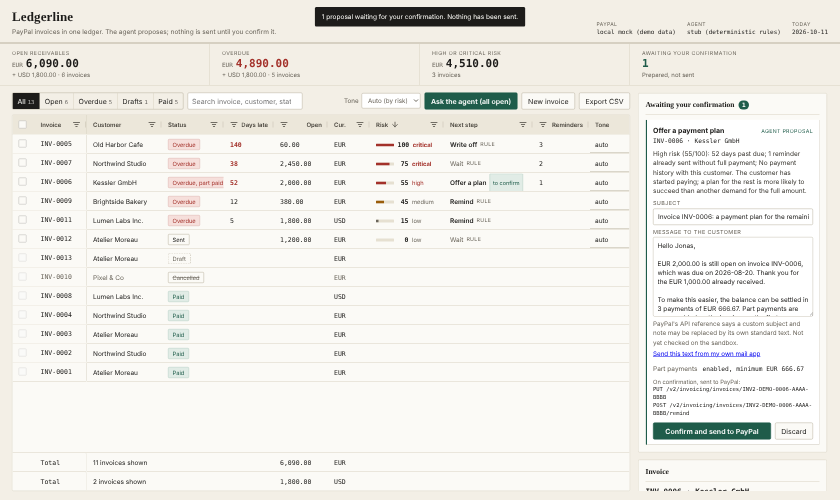

# Ledgerline

An invoice ledger for PayPal with a collections agent. The agent proposes; nothing is sent to
PayPal until a human has confirmed the exact action.



## What it is

Freelancers and very small businesses invoice through PayPal and then chase payments by memory.
Ledgerline puts every PayPal invoice in one grid and answers three questions for each unpaid one:
how worried should I be, what should I do next, and what do I write.

- **PayPal invoices.** The Invoicing v2 API is the only data source: list, read, create a draft,
  update, send, remind, record a payment, cancel, delete a draft.
- **AG Grid in the centre of the screen.** One row per invoice, sorted by risk, with filters, saved
  views, in-cell editing, row selection and per-currency totals pinned at the bottom.
- **An agent that proposes, a human who confirms.** For each unpaid invoice the agent gives a risk
  score with its reasons in plain words, a next step (remind, wait, offer a payment plan, write
  off) and a drafted message in the chosen tone. Each proposal stops in a queue. You read it, edit
  it if you want, and confirm or discard it. Every step is written to a hash-chained journal.

## Run the demo (no account, no key)

Requires Node 22 or later.

```sh
npm install
npm run demo        # http://127.0.0.1:4310
```

The demo starts a local stand-in for the PayPal API with thirteen sample invoices and uses a
deterministic rule-based stub in place of a language model. Nothing leaves your machine, and every customer,
amount and address in the sample data is invented. Try:
click a row to see why it is ranked where it is; "Ask the agent"; edit the drafted message;
confirm it and watch the row, the totals and the journal change; double-click the due date of the
draft invoice; create a new invoice.

## Run against the PayPal sandbox

1. Create a REST app at developer.paypal.com (sandbox) with Invoicing enabled.
2. `cp .env.example .env` and fill in `PAYPAL_CLIENT_ID` and `PAYPAL_CLIENT_SECRET`.
3. Optional, for a real model: set `MODEL_PROVIDER` to `openai` (any OpenAI-compatible
   chat-completions endpoint) or `anthropic`, with `MODEL_NAME`, `MODEL_API_KEY` and, if needed,
   `MODEL_BASE_URL`. Left on `stub`, the agent uses the rules alone.
4. `npm start`

The server binds to 127.0.0.1 only and refuses to start against live PayPal unless
`LEDGERLINE_ALLOW_LIVE=yes` is set. Secrets live in `.env`, which is git-ignored; they are never
logged, never journaled and never sent to the browser.

## How it works

| Path | Role |
| --- | --- |
| `src/paypal/client.ts` | Invoicing v2 client on plain `fetch`: OAuth2 client credentials, token cache, one retry on 401, retries on reads only. |
| `src/confirmation.ts`, `src/gate.ts` | The confirmation gate, the only path to a PayPal write. |
| `src/journal.ts` | Append-only JSONL journal; each entry carries the SHA-256 of the previous one. |
| `src/agent/risk.ts` | The risk rules and the allowed next steps. Deterministic. |
| `src/agent/model.ts` | The model interface, the stub, the HTTP client for a real model, and the output guard. |
| `src/ledger.ts`, `src/app.ts` | Grid rows, the agent run, and the local JSON API. |
| `src/mock/server.ts` | The local PayPal stand-in used by the demo and the tests. |
| `web/` | The page: AG Grid Community plus plain DOM, compiled with `tsc`, no bundler. |

**The gate.** Every PayPal write method takes a `Confirmation` object and throws before any
network request if it did not come from the gate. The gate mints one only when the caller sends
`confirm: true` together with the hash of the payload they were shown. It then re-reads the
invoice and refuses if its status or balance changed since the proposal (the customer may have
paid in the meantime). Proposals expire after 30 minutes, cannot be confirmed twice, and a failed
write is never retried. The preview of each proposal lists the exact PayPal calls it will make.

The local API is the gate's front door, so it is closed to everything but its own page: it only
answers requests addressed to `127.0.0.1` or `localhost` (a web page that points its own domain at
your machine gets a 403), refuses any foreign or `null` origin, and accepts JSON only. Any program
already running on your machine as you can still call it: it is a desk tool, not a vault.

**The risk rules.** Days past due set the base score; reminders already ignored, a history of
late payment and an unopened invoice raise it; a clean history and a part payment lower it. The
score, its level and its reasons are the same with or without a model, so they can be tested and
explained.

**The model.** It receives the facts of one invoice, the rule-based score and the list of allowed
actions. It chooses among those actions, explains its choice and writes the message. Its answer is
then checked: the action must be allowed, and every number in the message must be a fact of the
invoice (its amounts, its dates, its number, the days overdue, the plan). "A late fee of 50" or
"within 3 days" sends the answer to the bin: the rule-based draft is used and the reviewer sees why.
The model is given no free text from the invoice (no item lines, notes or memos), only names,
dates and amounts computed by the code. It cannot act: its answer can only become a proposal.

**AG Grid Community features used** (`ag-grid-community` 34.3.1, exact version pinned, MIT; no Enterprise module, no licence key):
sorting, text, number and date column filters, quick filter, external filter for the views, cell
editing with the text, date-string and select editors, custom cell renderers, multi-row selection
with checkboxes and `isRowSelectable`, pinned columns, pinned bottom rows recomputed from the
filtered rows, tooltips, CSV export, in-place updates through `getRowId`, and the Theming API.

## What is verified, and what is not

Verified here:

- `npm test`: 105 tests, all passing. They cover the PayPal client against the mock (auth, token
  refresh, pagination, each action, error handling, no retry on writes), the risk rules, the stub
  and the model guard, the request format for both model providers (against a fake endpoint), the
  confirmation gate (missing flag, wrong hash, double confirmation, race, expiry, stale invoice,
  failure), the journal (hash chain, tampering, persistence, no secret) and the HTTP API.
- `npm run check:ui`: one pass through the real page in Chromium with Playwright. The grid shows
  the thirteen invoices and two total rows, a confirmed reminder changes the row and the journal,
  and the browser console stays clean. Playwright is not a dependency; see the script header.

Checked on paper only:

- The PayPal client was compared, call by call, with PayPal's published OpenAPI description
  (`paypal/paypal-rest-api-specifications`, `openapi/invoicing_v2.json`, version 2.6) on
  11 October 2026: paths, methods, query parameters, bodies, status codes, error shape. That is a
  document, not a running PayPal.

Not verified (the hackathon requires a real PayPal sandbox and a real AI model in the product, so
the first two items below must be resolved before submission):

- **Checked on the real PayPal sandbox on 3 November 2026**: create, edit, send, remind, payment
  plan, partial and full payment, cancel, error bodies, paging. One fix came out of it (an empty
  JSON body for `generate-next-invoice-number`, which otherwise answers 415). The mock and the
  tests remain the only check of anything rarer.
- **A real model (Claude, through the Anthropic API) was run** on the sample ledger and on the
  sandbox; the demo and the tests use the stub.
- **PayPal does not deliver the reviewed wording.** As its API reference warns ("User-provided
  values for this field will not be honored"), the sandbox ignores the `subject` and `note` of
  send and remind: the invoice email shows PayPal's own subject and the invoice note, and the
  reminder email is a fixed template. The queue says so next to each message and offers to open
  the reviewed text in your own mail application.
- The demo journal starts with a few sample "past reminders", labelled as sample history, so the
  rules have something to read. They are not real reminders.

## Limits

- Two-decimal currencies only. Invoices in JPY, HUF, TWD and the like are listed, but Ledgerline
  refuses to write an amount in them and proposes no payment plan.
- The journal's hash chain shows an edited, removed or reordered entry. It has no key and no
  outside anchor: someone who can write the file can cut its last lines or rewrite it whole.
  `GET /api/journal` returns the head hash; noting it elsewhere is the only way to catch that.
- "Today" is the calendar day of the machine (or of `LEDGERLINE_TZ`, an IANA zone name).
- A payment plan is two PayPal calls. If the second fails, part payments stay enabled on the
  invoice and no reminder has gone out; the journal says at which step it stopped.
- PayPal limits an API caller to two reminders a day and does not cancel a partially paid
  invoice; the second is enforced before anything is proposed, the first is left to PayPal.
- The number check on drafted messages cannot see numbers spelled out in words.
- Single user, local: no login; the server only listens on loopback.
- Proposals waiting for confirmation are kept in memory and are lost on restart. The journal is
  on disk.
- The reminder count comes from Ledgerline's own journal: PayPal's API does not report reminders
  sent from elsewhere.
- Drafted messages are in English. Up to 500 invoices are loaded.
- The risk score is a transparent heuristic, not a credit assessment.

## How this was made

The idea, the code and this README were written by Claude, an AI model made by Anthropic. The
submitter set up the PayPal sandbox and model accounts and was present for the sandbox run; no
human wrote or reviewed the code line by line.

## License

MIT. See [LICENSE](LICENSE).
